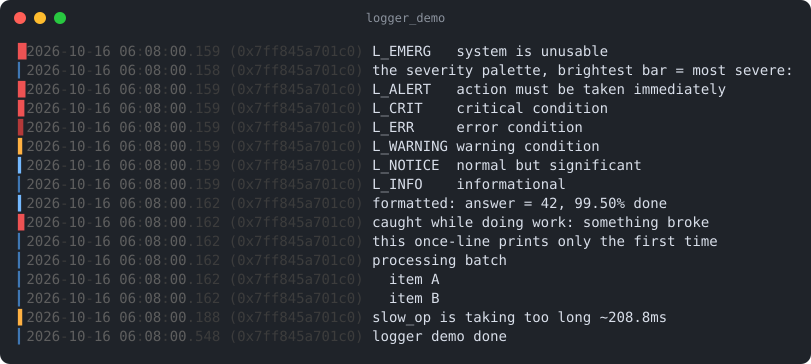

# logger

Part of [Kronuz C++ Libraries](https://github.com/Kronuz/cpp-libraries), a collection of small, reusable C++ libraries.

[](https://github.com/Kronuz/logger/actions/workflows/ci.yml)
[](LICENSE)


Lock-free, deferred logging for C++20: many threads log without blocking each
other, one thread writes in order, and a "this is taking too long" line can be
armed and cancelled with one atomic, so fast operations log nothing. For
servers that want to log slow operations only.



## ✨ Highlights

- **Never blocks the caller.** Routine lines are handed to the log thread through
  the lock-free [stash](https://github.com/Kronuz/stash) wheel; severe lines
  write immediately.
- **Log slow operations only.** `L_DELAYED_200("request {} is slow", id)` fires
  only if it is not cancelled within 200 ms, annotated with how long it ran.
- **`std::format` messages**, and arguments are not even evaluated below the
  log level.
- **Once, once per minute, stacked indentation, and timed lines.**
- **Terminal-aware color** through [term-color](https://github.com/Kronuz/term-color):
  honors `--color`-style modes and `NO_COLOR`, with iTerm2 marks and badges.
- **Backpressure.** `max_pending` drops routine lines past a cap and reports how
  many.
- **Hooks for the host**: exception descriptions, backtraces, thread names, and
  timestamps.

## 📦 Installation

Requires a C++20 compiler and CMake 3.14 or newer; it fetches
[scheduler](https://github.com/Kronuz/scheduler) (with threadpool and stash) and
term-color, and compiles one source file. CI builds it on Linux (x86_64, arm64),
macOS (arm64, x86_64), and FreeBSD, plus ASan, UBSan, and TSan builds.

```cmake
include(FetchContent)
FetchContent_Declare(logger
  GIT_REPOSITORY https://github.com/Kronuz/logger.git
  GIT_TAG        main)
FetchContent_MakeAvailable(logger)

target_link_libraries(my_app PRIVATE logger::logger)
```

## 🚀 Quick start

```cpp
#include "logger.h"

void handle_request(int);   // your code
void risky();

int main() {
	Logging::config.log_level = LOG_INFO;
	Logging::add_handler(std::make_unique<StderrLogger>());

	L_INFO("starting up, {} workers", 8);

	{
		L_DELAYED_200("request {} is slow", 42);   // armed for 200 ms
		handle_request(42);
		L_DELAYED_N_CLEAR();                      // fast enough: never prints
	}

	try { risky(); } catch (...) { L_EXC("risky() failed"); }   // logs the exception
	Logging::finish();                                          // drain before exit
}
```

[`examples/demo.cc`](examples/demo.cc) tours every level, deferred lines, once
dedup, stacked indentation, and the iTerm2 integration.

## 🎯 When to use it

- ✅ Logging from many threads on hot paths, with ordered output.
- ✅ "Warn me only if this is slow" around requests, commits, or locks.
- ❌ Structured logging (JSON fields, log shipping): sinks receive formatted
  text lines.
- ❌ A single-threaded tool: plain `std::fprintf(stderr, …)` is simpler.

## 📚 Documentation

- [docs/API.md](docs/API.md): `LogConfig`, `LogHooks`, sinks, the macros, and the
  `Log` handle.
- [ARCHITECTURE.md](ARCHITECTURE.md): the three paths a line takes, and how
  cancel and swap work.
- [docs/ROADMAP.md](docs/ROADMAP.md): open design work, such as isolating slow
  sinks.
- [AGENTS.md](AGENTS.md): repository map, invariants, and traps.

## 🛠️ Building and testing

```sh
cmake -B build && cmake --build build && ctest --test-dir build
./build/logger_demo
```

## 🤝 Contributing

Issues and pull requests are welcome. Read [AGENTS.md](AGENTS.md) first. CI must
pass on every platform.

## 📄 License

MIT, Copyright (c) 2015-2019 Dubalu LLC. See [LICENSE](LICENSE). Extracted from
[Xapiand](https://github.com/Kronuz/Xapiand), which now builds on this library.
