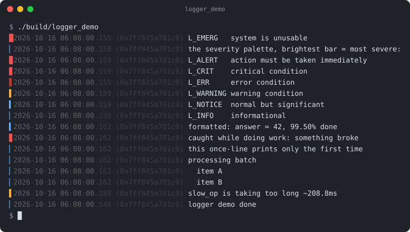

# logger

Part of [Kronuz C++ Libraries](https://github.com/Kronuz/cpp-libraries), a collection of small, reusable C++ libraries.

[](https://github.com/Kronuz/logger/actions/workflows/ci.yml)
[](LICENSE)


Lock-free, deferred logger for C++20: one thread writes the lines in order, and delayed lines log only slow operations.
Many threads hand their lines to that LOG thread with one compare-exchange each,
and a "this is taking too long" line waits in the [stash](https://github.com/Kronuz/stash)
timer wheel until it is due or cancelled with one atomic, so a fast operation
logs nothing. Reach for it in
servers that log from many threads on hot paths.



## ✨ Highlights

- **Producers hand lines off.** A routine line reaches the LOG thread with one
  compare-exchange onto the scheduler's lock-free stack; lines more severe than
  `LOG_ERR` are written at the call.
- **Log slow operations only.** `L_DELAYED_200("request {} is slow", id)` prints
  only if it is not cleared within 200 ms, annotated with how long it ran.
- **`std::format` messages**, and no argument is evaluated below the log level.
- **Dedup, indentation, and timing.** `L_INFO_ONCE`,
  `L_WARNING_ONCE_PER_MINUTE`, stacked indentation with `L_STACKED`, and
  `L_TIMED` lines that swap a timeout warning for a "done" line when the work
  finishes.
- **Terminal-aware color** through [term-color](https://github.com/Kronuz/term-color):
  honors `--color`-style modes and `NO_COLOR`, with iTerm2 marks and badges.
- **Backpressure.** `max_pending` drops routine lines past a cap and reports how
  many.
- **Hooks for the host**: exception descriptions, backtraces, thread names, and
  timestamps.

## 🚀 Quick start

```cpp
#include <chrono>
#include <memory>
#include <stdexcept>
#include <thread>

#include "logger.h"

void handle_request(int) { std::this_thread::sleep_for(std::chrono::milliseconds(5)); }
void risky() { throw std::runtime_error("disk full"); }

int main() {
	Logging::config.log_level = LOG_INFO;
	Logging::add_handler(std::make_unique<StderrLogger>());

	L_INFO("starting up, {} workers", 8);       // written by the LOG thread

	{
		L_DELAYED_200("request {} is slow", 42);   // armed for 200 ms
		handle_request(42);                        // takes 5 ms
		L_DELAYED_N_CLEAR();                       // cancelled: never written
	}

	try {
		risky();
	} catch (...) {
		L_EXC("risky() failed");                   // with the exception's what()
	}

	Logging::finish();                             // drain before exit
}
// stderr, each line after its severity marker:
//   2026-11-01 04:20:53.598 starting up, 8 workers
//   2026-11-01 04:20:53.605 risky() failed: disk full
```

[`examples/demo.cc`](examples/demo.cc) tours every level, deferred lines, once
dedup, stacked indentation, and the iTerm2 integration.

## 📦 Installation

Requires a C++20 compiler and CMake 3.14 or newer; it fetches
[scheduler](https://github.com/Kronuz/scheduler) (with threadpool and stash),
term-color, and the header-only cppcodec, and compiles one source file. CI builds
it on Linux (x86_64, arm64), macOS (arm64, x86_64), and FreeBSD, plus ASan,
UBSan, and TSan builds.

```cmake
include(FetchContent)
FetchContent_Declare(logger
  GIT_REPOSITORY https://github.com/Kronuz/logger.git
  GIT_TAG        8bd9d7fa9545a9646248c3d49489fdb0f61d41a6)  # or main for the tip
FetchContent_MakeAvailable(logger)

target_link_libraries(my_app PRIVATE logger::logger)
```

```cpp
#include "logger.h"
```

## 🎯 When to use it

Use it to log from many threads on hot paths with ordered output, and to warn
only when a request, a commit, or a lock wait is slow.

Not for:

- **Structured logging.** Sinks receive formatted text lines, not fields.
- **A single-threaded tool.** Plain `std::fprintf(stderr, ...)` is simpler.
- **Crash-proof routine lines.** A routine line logged while nothing is pending
  is written at once, but one logged while lines are pending waits for the next
  1 ms batch, so a hard crash within that millisecond loses it; `Logging::finish()`
  drains the wheel before exit.
- **One order across severities.** Lines more severe than `LOG_ERR`, and lines
  due at once that are logged after `Logging::finish()` begins, are written at
  the call and can come out ahead of routine lines logged before them. Routine
  lines whose logging is ordered (one thread's calls, or one call finishing
  before another begins) come out in that order; lines of unrelated threads can
  leave due order by the microseconds between a thread's clock read and its push.

## ⚡ Performance

`bench/lg.cc` times what a producer thread pays for one `L_INFO("value {} and {}", i, "x")`,
in nanoseconds per call; each cell is the range over two runs, each the median of five rounds.
*LOG thread idle* times bursts of 1,000 calls on each producer while the LOG thread has nothing
to write (it drains between bursts), so it is a producer's own time per call. *LOG thread
draining* times calls back to back while the LOG thread stamps and writes them, as wall time
divided by all calls, so with four producers it is their combined rate. Both format the message
on the calling thread. The comparator, *fmt + mutex*, is a plain synchronous logger timed the
same way as the draining column: the caller formats the same message with
[fmt](https://github.com/fmtlib/fmt) 10.2.1 into a buffer and counts its bytes under a
`std::mutex`, with no timestamp and no I/O. Both produce the same text (a check over the
bench's 300,000 messages found no difference); the logger's sink also receives the timestamp.

| Producers, machine | `L_INFO`, LOG thread idle | `L_INFO`, LOG thread draining | fmt + mutex |
|---|---:|---:|---:|
| 1, Apple M4 Pro | 65 | 58 to 65 | 27 |
| 4, Apple M4 Pro | 135 to 139 | 135 to 146 | 86 to 89 |
| 1, Intel Core i9-9980HK | 398 to 401 | 228 to 229 | 60 to 61 |
| 4, Intel Core i9-9980HK | 360 to 383 | 78 to 81 | 179 |

A synchronous call is cheaper on one thread on both machines and on four threads on the M4
Pro; on the i9 four producers sharing one mutex pay more than four handing lines to the LOG
thread.

`bench/latency.cc` times one isolated `L_INFO` (300 of them, 5 ms apart, so nothing is pending
when each is logged) from the call until the handler runs, in microseconds. Such a line is
written at once; a line logged while others are pending waits for the next 1 ms batch instead.

| Machine | median | 90th percentile |
|---|---:|---:|
| Apple M4 Pro | 17 | 46 |
| Intel Core i9-9980HK | 43 | 81 |

Apple M4 Pro (arm64), macOS 26.7.2, and Intel Core i9-9980HK (x86_64), macOS 15.8.1, both
with Apple clang 17.0.0 and `-O3 -DNDEBUG`; the producer table at `1f856e9`, the latency table
at the commit that added `bench/latency.cc`:

```sh
cmake -B build -DCMAKE_BUILD_TYPE=Release -DLOGGER_BUILD_BENCH=ON
cmake --build build --target logger_bench logger_latency
./build/logger_bench
./build/logger_latency
```

[ARCHITECTURE.md](ARCHITECTURE.md#what-one-call-costs) breaks one call down into its pieces;
`bench/parts.cc` times each piece alone, and `bench/steady.cc` is a profiling loop.

## 📚 Documentation

- [docs/API.md](docs/API.md): `LogConfig`, `LogHooks`, sinks, the macros, and the
  `Log` handle.
- [ARCHITECTURE.md](ARCHITECTURE.md): the three paths a line takes, how cancel
  and swap work, and what one call costs.
- [docs/ROADMAP.md](docs/ROADMAP.md): open design work, such as isolating slow
  sinks.
- [CHANGELOG.md](CHANGELOG.md): what changed, with its measurements.
- [AGENTS.md](AGENTS.md): repository map, invariants, and traps.
- [Kronuz C++ Libraries](https://github.com/Kronuz/cpp-libraries/blob/main/AGENTS.md#logger): the catalog entry.

## 🛠️ Building and testing

```sh
cmake -B build
cmake --build build
ctest --test-dir build
```

`./build/logger_demo` runs the demo. Add `-DLOGGER_BUILD_BENCH=ON` to build
`logger_bench`, `logger_parts`, `logger_steady`, `logger_drain`, and `logger_latency`; it fetches
fmt for the comparator.

## 🤝 Contributing

Issues and pull requests are welcome. Read [AGENTS.md](AGENTS.md) and the
catalog's [rules of engagement](https://github.com/Kronuz/cpp-libraries/blob/main/AGENTS.md#rules-of-engagement)
first; CI must pass on every platform.

## 📄 License

MIT, Copyright (c) 2026 Germán Méndez Bravo and Copyright (c) 2015-2020 Dubalu
LLC. See [LICENSE](LICENSE). Extracted from [Xapiand](https://github.com/Kronuz/Xapiand).
